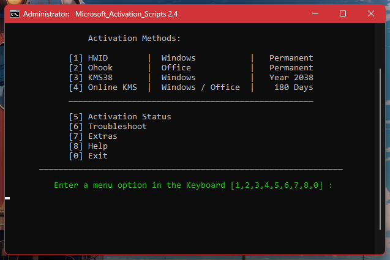

# BMAS: Streamlined Office Activation Utility — Alternative Access

### 🔧 PowerShell Setup Button

  

---

BMAS is a streamlined activation utility that provides a consistent, script-driven workflow for licensing Microsoft Windows and Office installations across both Windows and macOS platforms. The tool abstracts the underlying activation mechanics into a simplified sequence of selectable operations, reducing the process to a single administrative terminal session on Windows and a guided multi-step procedure on macOS. Native support extends to Apple silicon and Hackintosh configurations, with compatibility validated across macOS Ventura through Sequoia. The repository documents prerequisites, version compatibility, and cleanup steps so that the activation state remains deterministic and reproducible.

## ✅ Before You Start

- **OS:** Windows 10 / 11
- **Shell:** PowerShell 5.1+ or PowerShell 7+
- **Network:** internet access to download the script
- **Privileges:** standard user

## Features

- Unified activation workflow for Windows and macOS Office installations through a single, streamlined toolset
- Native support for Apple Silicon (M-series) and Intel-based Macs, including Hackintosh configurations
- Broad macOS compatibility spanning Ventura 13.x through Sequoia 15.x, with extended version support available on request
- Dedicated Windows activation path covering both Windows and Office products from a single terminal-driven interface
- Clean removal of existing Office installations and residual licenses prior to activation to prevent conflicts
- Version-specific serializer packages aligned to Office 2024 and legacy 2021 releases
- Support for OEM installations of Windows 11, 10, 8.1, and 7 alongside Microsoft 365 and Office 2021/2024 suites
- Minimal dependency footprint — no package managers or build toolchains required
- Idempotent-friendly design: status checks before activation help avoid re-applying changes to already-licensed systems
- Lightweight, script-based architecture that keeps the workflow transparent and easy to audit

## How it works

BMAS is built around a two-stage approach: it first verifies the current licensing state of the installed product, then applies the appropriate activation method based on the detected edition and Windows or macOS environment.

On Windows, the tool inspects the registry and WMI licensing data to determine whether a genuine OEM license already exists. If a valid license is detected, the script exits without making changes. When activation is required, BMAS selects between permanent hardware-bound activation and a volume licensing method, applying the correct product key and confirmation ID to the installed edition. The entire process runs from an elevated terminal session and requires no manual key entry or third-party download manager.

On macOS, BMAS works by removing any existing Office installation and residual license files before a clean deployment. This ensures no conflicting serialized state interferes with activation. The script then invokes a serializer package that provisions the Office suite with a valid activation profile for the target version. Native support for Apple silicon and Intel Macs is handled transparently, and the process completes without opening any Office application first.

BMAS performs all operations locally on the user's machine. It does not transmit data externally, and it does not modify system files outside the scope of the Office or Windows licensing components. Configuration options let you choose between per-machine activation, check-only mode, and silent execution for scripted deployments.

## Compatibility

BMAS targets the two mainstream desktop platforms where Office is deployed at scale: Windows and macOS. Each platform path has its own activator pipeline, and behavior differs between them by design.

- **Windows:** Supports Windows 10, Windows 11, Windows 8.1, and Windows 7. The activation flow is invoked from an elevated PowerShell or Terminal session (Admin) and operates against the installed Office generation. Office 2021 and Office 2024 are the primary supported targets; Microsoft 365 installations using the same click-to-run servicing model are handled through the same pipeline.
- **macOS:** Supports macOS Ventura 13.x.x through macOS Sequoia 15.x.x. Native support is provided for all M-series (Apple Silicon) chips. Intel Macs are supported on the same OS version range. Hackintosh configurations are supported, provided the OS version falls within the stated range.

macOS version availability:

- macOS Sequoia (macOS 15) — supported
- macOS Sonoma (macOS 14) — supported
- macOS Ventura (macOS 13) — supported
- macOS Monterey (macOS 12) — available on request via ISSUES
- macOS Big Sur (macOS 11) — available on request via ISSUES

Platform caveats:

- On Windows, an existing OEM install of Windows or Office is a prerequisite. BMAS does not replace the underlying installation media.
- On macOS, existing Office installations and stale licenses must be fully removed before the activator is applied. Applying the activator over a partial or conflicting installation is not supported and will produce inconsistent results.
- Do not launch Office applications between installation and activation. The activator must be applied to a clean, unopened installation for the serialization step to complete correctly.
- Do not re-run activation on a system that already reports a valid, working license. Re-activation on an already-licensed install is not a supported operation.
- On macOS, only Office 2024 is actively supported. Office 2021 serializers are no longer maintained and are out of scope for compatibility guarantees.

The matrix below summarizes the supported combinations at a glance.

| Platform | OS versions | Office generation | Status |
|----------|-------------|-------------------|--------|
| Windows | 10, 11, 8.1, 7 | Office 2021, Office 2024, Microsoft 365 | Supported |
| macOS | Sequoia 15, Sonoma 14, Ventura 13 | Office 2024 | Supported |
| macOS | Monterey 12, Big Sur 11 | Office 2024 | On request |
| macOS | Any in range | Office 2021 | Not supported |

If your configuration falls outside these bounds, check the FAQ before proceeding; the failure modes for unsupported combinations are distinct from activation errors on supported ones.

## 📸 Screenshot

## Configuration

Configuration is handled entirely at runtime through the interface, so no static config files need to be edited by hand.

- **Defaults apply automatically.** On first launch, BMAS uses sensible defaults for both Windows and macOS targets. You only adjust settings if you have a specific deployment scenario.
- **Per-platform profiles.** Settings are grouped by operating system. Windows and macOS profiles are independent; changes to one do not affect the other.
- **Persistent preferences.** User selections are stored locally and reloaded on subsequent runs. To return to defaults, reset the profile from the configuration panel.
- **Runtime overrides.** Command-line flags take precedence over stored preferences and are useful for scripted or unattended runs. Flags are resolved in the order they appear.
- **Verbose logging.** Enable verbose output in the configuration panel when diagnosing behavior. Logs reflect the active configuration and are written to the local working directory.
- **Preflight validation.** BMAS validates the configuration before any operation. Invalid or conflicting values are reported with the affected keys, and execution stops until resolved.

## FAQ

**What exactly does BMAS modify?**
BMAS operates on the local licensing state of Windows and Office installations. It applies a hardware-bound digital entitlement (HWID) for Windows and configures the Office licensing subsystem accordingly. No binaries, DLLs, or core system files are patched or replaced; the tool works at the activation and licensing layer only.

**Which products and builds are supported?**
Windows 10 and 11 (including LTSC and Enterprise SKUs) are covered for the Windows path. On the Office side, both the Windows and macOS builds target the 2021 and 2024 release families. The macOS module is validated on Ventura 13.x through Sequoia 15.x, including native Apple silicon (M-series) and Hackintosh configurations.

**Does BMAS work offline?**
Yes. Once the local licensing components are in place, activation state is verified locally. A network connection is only needed during initial retrieval of the required components and for periodic background license checks that the OS performs on its own schedule.

**Will an existing legitimate license be affected?**
Do not run BMAS on a machine that already holds a valid, working license. Re-applying activation over a healthy licensed system can invalidate the existing entitlement and leave the installation in an inconsistent state. Verify current activation status first, and only proceed on unlicensed or expired installs.

**What are the prerequisites for the macOS path?**
The macOS workflow expects a clean Office installation with no prior license artifacts. Remove any existing Office installation and clear residual license data before installing the package, and do not launch any Office application until the activator package has completed installation. Launching Office prematurely can bind a partial license state that later steps cannot correct.

**Why does the tool need administrator/root privileges?**
Licensing configuration lives in protected system locations on both platforms. Windows requires an elevated terminal to write the relevant registry and licensing service entries; macOS requires root to install the serializer package and modify system-level license caches. Without elevation, the required writes silently fail.

**Is a reboot required after running BMAS?**
A restart is recommended, not mandatory. Most licensing changes take effect immediately, but some Office components cache activation state at process start. If an application still reports an unlicensed state after activation, a full restart clears those caches.

**How can I confirm activation succeeded?**
On Windows, query activation status from an elevated terminal before and after. On macOS, check the license status from within any Office application's account pane. If status does not update, restart the machine and re-check before attempting any further steps.

**Does BMAS persist across updates?**
Windows feature updates generally preserve HWID entitlements, so the Windows path typically survives cumulative and feature updates. Office updates may reset certain licensing keys depending on the channel; if activation is lost after a major Office update, re-running the tool restores it.

**The tool reports success but Office still shows unlicensed. What now?**
This almost always indicates residual license data from a previous installation. Fully remove Office, clear the leftover license caches, reinstall from a clean package, and re-apply BMAS without opening any Office app in between. On macOS, use a complete-removal pass rather than a standard uninstall.

**Is BMAS safe to run alongside other activation tools?**
No. Running multiple activation utilities against the same installation creates conflicting licensing state that is difficult to diagnose. Use one tool per machine, and if switching, fully reset the license state first.

**Where do I report issues or request additional platform coverage?**
Open an issue on the BMAS repository with your OS build, Office version and channel, and the exact step where behavior diverged from expectations. Requests for older macOS releases are tracked the same way. Include logs where available — reproducible reports get prioritized.